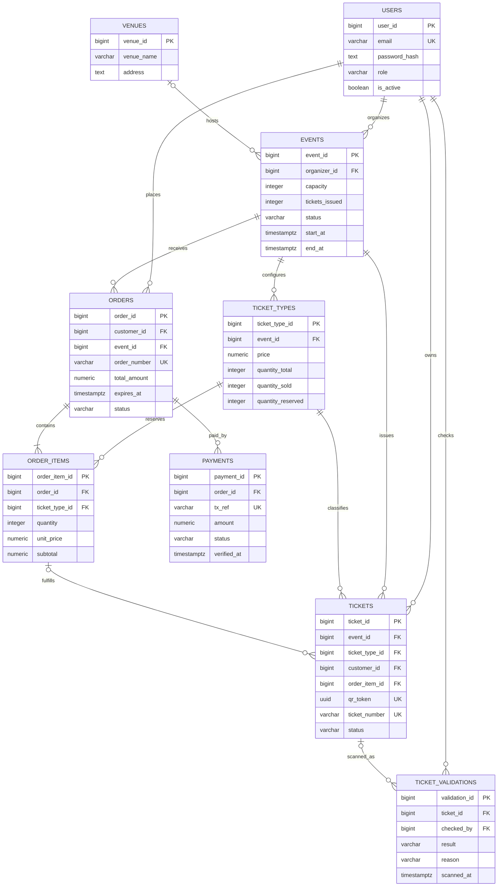

# Database design

PostgreSQL is the source of truth. The initial schema is
[`event_ticket_booking_schema.sql`](../event_ticket_booking_schema.sql);
TypeORM schema synchronization is disabled. Order/payment tables and the
ticket-to-order-item reference are introduced by migrations.

## Entity relationship diagram

`VENUES` and some event descriptive fields are schema capabilities not
currently exposed by the event DTOs. Treat the REST DTOs and Swagger document
as the current API contract.

## Important constraints and invariants

- User email, ticket number, QR token, order number, and payment transaction
  reference are unique.
- Event checks enforce `end_at > start_at`, nonnegative capacity and issued
  count, and `tickets_issued <= capacity`.
- A ticket type belongs to one event. Its `quantity_sold` and
  `quantity_reserved` cannot exceed `quantity_total`.
- Ticket statuses are `ISSUED`, `USED`, `CANCELLED`, or `REFUNDED`.
- Order statuses are `PENDING`, `PAID`, `CANCELLED`, or `EXPIRED`.
- Payment statuses are `PENDING`, `SUCCESS`, `FAILED`, or `CANCELLED`.
- Deleting events with tickets/orders is restricted; cancellation preserves
  history.
- Indexes support event discovery, organizer lookup, customer ticket history,
  unassigned ticket selection, and validation history.

## Capacity and lifecycle

Configured availability for one ticket type is
`quantity_total - quantity_sold - quantity_reserved`. A customer can claim
only existing, unassigned generated tickets. A ticket-generation transaction
locks the event and checks that the additional ticket records fit under event
capacity. Purchase operations lock the relevant inventory rows and update
ticket ownership and sold/reserved counters transactionally.

An unpaid order reserves quantity until its 15-minute expiry. Successful
provider verification fulfills tickets and transfers reserved quantity to
sold quantity. A ticket moves from `ISSUED` to `USED` on its first accepted
scan. Rejected and accepted scans are represented in `ticket_validations`.

For a new database, initialize the base schema and run all migrations. Existing
volumes are not reinitialized by PostgreSQL's Docker entrypoint; back them up
before applying schema changes.
