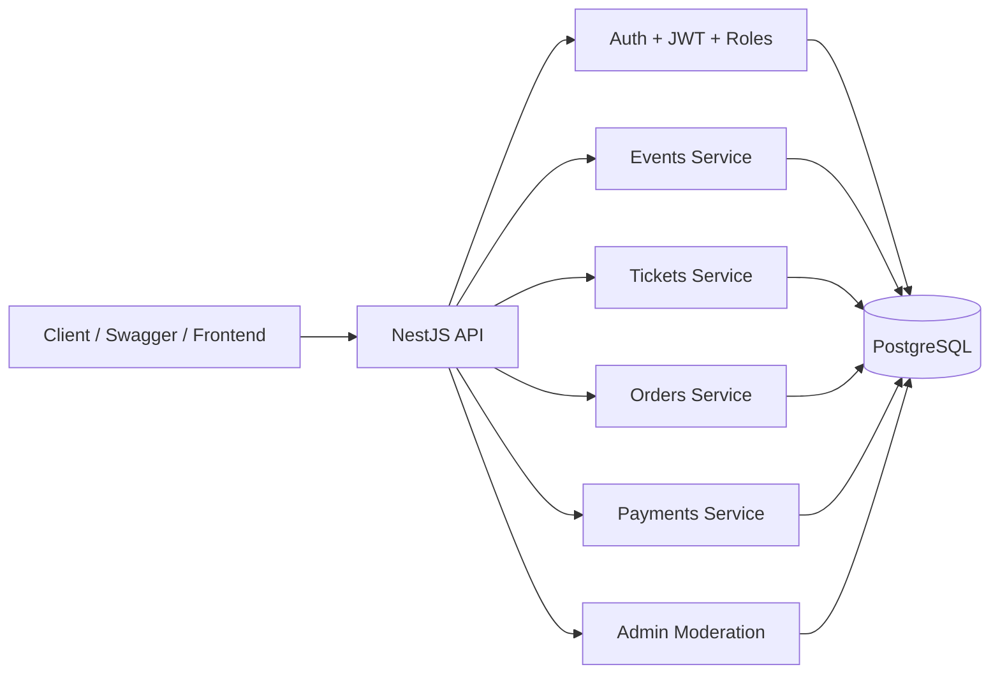

# System Architecture

## Backend architecture

The project is a NestJS application using modular controllers, services, guards, DTOs, and TypeORM entities.

The main application module wires together:

- AuthModule
- UsersModule
- EventsModule
- CapacityModule
- TicketsModule
- TicketTypesModule
- OrdersModule
- OrganizersModule
- PaymentsModule

The application loads environment variables through `@nestjs/config` and validates them using Joi. Database access is handled through TypeORM and a custom `DatabaseService` used by order logic and ticket logic.

## Component structure

- `src/auth` handles registration, login, JWT generation, and role-based access checks.
- `src/users` handles user management, role changes, and account status changes.
- `src/events` handles event creation, update, searching, ownership rules, and public lookup.
- `src/ticket-types` handles ticket categories, pricing, inventory, and summary reporting.
- `src/tickets` handles ticket generation, QR generation, validation, and check-in summaries.
- `src/orders` handles reservations and order creation.
- `src/payments` handles PayChangu checkout and verification.
- `src/organizers` handles organizer staff and KYC features.
- `src/admin` handles moderation endpoints and audit log reviews.

## Database architecture

PostgreSQL is the primary database. The schema includes the main tables:

- `users`
- `events`
- `ticket_types`
- `tickets`
- `ticket_validations`
- `orders`
- `order_items`
- `payments`
- `organizer_staff`
- `staff_event_assignments`
- `organizer_kyc`
- `contact_messages`
- `audit_logs`

The project uses TypeORM entity auto-loading and a migration-based setup with SQL migrations in `src/database/migrations`.

## Authentication and authorization flow

1. A user registers through `POST /auth/register`.
2. A login request returns a JWT access token.
3. Protected routes use `JwtAuthGuard` and `RolesGuard`.
4. The current user is extracted from the token payload.
5. Roles are checked before business logic runs.

The system uses:

- `bcryptjs` to hash and compare passwords.
- `passport-jwt` with a JWT strategy.
- role checks via custom decorators and guards.

## Public and protected access patterns

Public endpoints include:

- `GET /`
- `POST /auth/register`
- `POST /auth/login`
- `GET /events`
- `GET /events/:id`
- `GET /events/:id/availability`
- `GET /events/:id/ticket-types`

Protected endpoints require a bearer token and often additional role restrictions.

## Request lifecycle

1. A client sends an HTTP request.
2. NestJS resolves the route and validation DTO.
3. JWT auth and role guards run when required.
4. A controller calls a service.
5. The service performs SQL transactions and validation logic.
6. The service returns response data or throws NestJS exceptions.
7. Swagger documents the endpoint contract.

## Architecture diagram

## Notes on the current implementation

- There is no standalone frontend application in this repository.
- The API is the primary system boundary.
- Database integrity rules are enforced in both application logic and SQL constraints.
- QR validation and payment verification are centralized in service layer checks.
