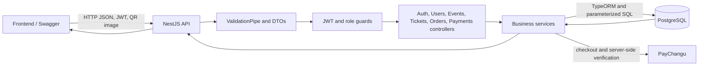
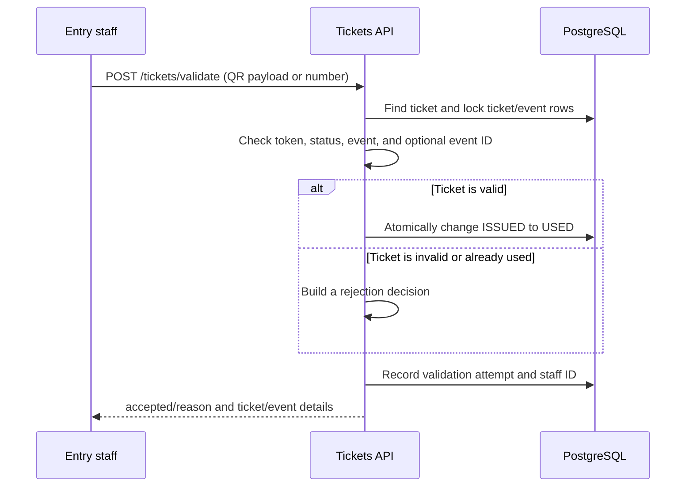

# System architecture

## Overview

The system is a modular NestJS REST API backed by PostgreSQL. HTTP controllers
bind routes, DTOs validate input, guards authenticate and authorize users,
and services implement business rules. TypeORM handles event/auth persistence;
the database module uses parameterized PostgreSQL queries for ticket inventory,
orders, and payment workflows.



## Module responsibilities

- Auth and users: bcrypt password hashing, JWT issue/verification,
  administrative role changes, and user lookup.
- Events: event lifecycle, manager ownership, public discovery, and event
  metadata.
- Capacity: public event availability calculated from configured and
  generated inventory.
- Ticket types: ticket inventory allocation, sales windows, stock
  indicators, and attendance summaries.
- Tickets: generation, ticket claims, customer history, QR creation,
  ticket validation, and check-in.
- Orders: time-limited ticket reservations and order fulfillment after
  verified payment.
- Payments: PayChangu checkout, HMAC webhook verification, and
  provider-side payment verification.
- Database: PostgreSQL connection pool and TypeORM migrations.

## Request and ticket flows

For a protected route, NestJS parses the request, applies the global
`ValidationPipe` (`whitelist`, `forbidNonWhitelisted`, and `transform`), checks
the JWT, then enforces any role requirement. Services apply additional
ownership and state checks before touching PostgreSQL. Errors use NestJS
exception responses.

### Free ticket claim

```mermaid
sequenceDiagram
  participant U as Customer
  participant A as Tickets API
  participant D as PostgreSQL
  U->>A: POST /tickets/purchase (event, type, quantity)
  A->>D: Lock event and ticket type; verify status, dates, stock, limits
  A->>D: Lock available generated tickets (SKIP LOCKED)
  A->>D: Assign tickets and increment sold quantity
  D-->>A: Commit transaction
  A-->>U: Ticket numbers and QR images
```

Ticket records are generated from configured ticket-type quantities first.
The claim endpoint assigns existing records; it does not create extra
inventory. Paid checkouts instead create an order and reserve ticket-type
quantity. Provider verification precedes transactional order fulfillment.

### Entry validation



The row lock and conditional status update prevent two concurrent scans from
both consuming the same ticket. The ticket's QR payload includes its database
ID and a separate random token; it does not include customer credentials.

## Database interaction

The SQL schema in `event_ticket_booking_schema.sql` is the base schema for a
fresh PostgreSQL database. TypeORM `synchronize` is disabled. The later
migrations create order/payment tables and associate tickets with order items.
Do not assume an existing database volume has run either the base schema or
the migrations; follow the README migration instructions.

See [Database design](./DATABASE_DESIGN.md) for entities and relationships,
and [Security](./SECURITY.md) for authentication and integrity controls.
